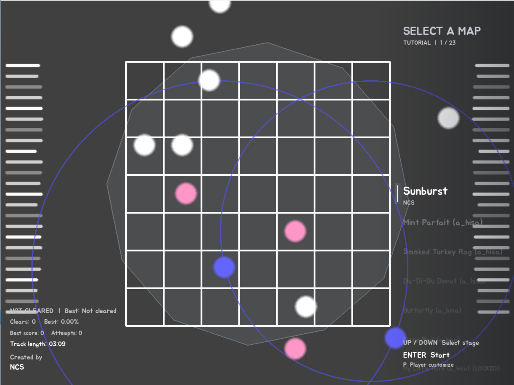
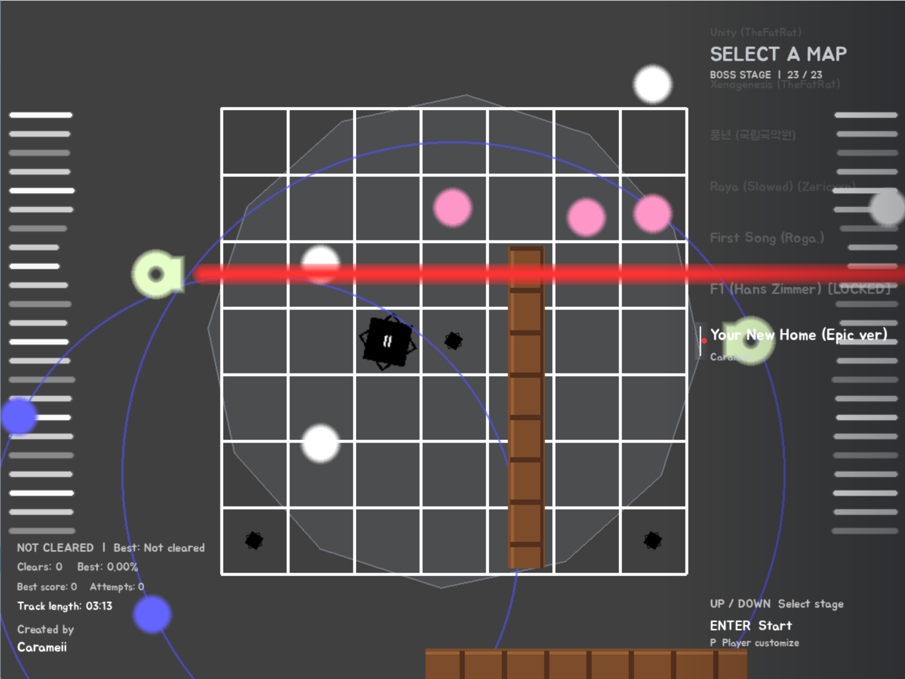

# 🎵 7x7 Rhythm Game (v1.0.0)





> **음악의 흐름에 맞춰 7×7 보드 위에서 장애물을 피하고, 곡이 끝날 때까지 살아남는 리듬 액션 게임입니다.**

---

## 🎮 게임 소개

`7x7 Rhythm Game`은 박진감 넘치는 음악에 맞춰 다양한 패턴의 장애물을 회피하는 Pygame 기반의 싱글 플레이 리듬 회피 게임입니다. 
총 23개의 매력적인 스테이지와 음악 비주얼라이저, 그리고 플레이어 커스터마이징 기능을 제공합니다!

### ✨ 주요 기능
- **23개의 정규 음악 스테이지** — 일반 스테이지 19개와 도전 의식을 자극하는 보스 스테이지 4개
- **개별 보스 해금 시스템** — 특정 조건(진행률/클리어 등)을 달성하여 잠긴 보스 곡을 해금하는 재미
- **음악 반응형 비주얼라이저** — 24개 주파수 대역을 분석하여 음악의 리듬과 특징에 반응하는 시각 효과
- **플레이어 커스터마이징** — 플레이어 색상 및 피격 이펙트 변경 기능 제공 (`P` 키)
- **자동 기록 저장** — 최고 진행률, 클리어 횟수, 최고 등급 등 본인의 성장 기록 자동 보관

---

## 🎮 조작 방법

| 구분 | 키 입력 | 동작 |
|---|---|---|
| **메뉴 / 이동** | `↑` `↓` `←` `→` | 스테이지 선택 및 게임 중 캐릭터 이동 |
| **선택 / 시작** | `Enter` 또는 `Space` | 선택한 스테이지 시작 |
| **일시정지** | `Esc` (짧게) | 게임 재개 |
| **메뉴로 돌아가기** | `Esc` (길게) | 스테이지 선택 화면으로 이동 |
| **재시작** | `R` 또는 `Space` (길게) | 빠른 스테이지 재시작 |
| **커스터마이징** | `P` (메인 화면) | 캐릭터 색상 & 피격 이펙트 설정 |

---

## 🏁 스테이지 & 보스 해금 조건

총 23개의 곡이 준비되어 있으며, 보스 스테이지는 지정된 해금 조건을 달성해야 플레이가 가능합니다.

- 🔒 **Stage 07. My Little Hero (Boss)** — Stage 1~6 모두 진행률 30% 이상
- 🔒 **Stage 12. Megalovania (Boss)** — Stage 10, 11 모두 클리어
- 🔒 **Stage 22. F1 (Boss)** — Stage 17~21 모두 진행률 30% 이상
- 🔒 **Stage 23. Your New Home (Boss)** — Stage 1~22 모두 진행률 20% 이상

---

## ⚠️ 장애물 안내

장애물은 보드 바깥에서 나타나거나 보드 위에서 움직이며, 플레이어와 충돌하면 HP를 잃습니다. 움직임과 경고 표시를 살펴 빈 칸으로 피하세요.

| 장애물 | 특징 | 대응 요령 |
|---|---|---|
| 기본 공 (Ball) | 흰색 공이 생성된 방향과 속도에 따라 직선으로 이동합니다. 기존 기본 속도보다 32% 빠르게 이동합니다. | 공의 진행 방향을 보고 옆 칸이나 빈 줄로 이동합니다. |
| 궤도 공 (TBall) | 파란 공이 원형 궤도를 따라 회전합니다. 생성 직전에는 `!` 경고가 표시됩니다. | 경고가 나타나면 궤도 주변을 피하고, 공의 회전 경로가 지나간 뒤 이동합니다. |
| 부메랑 공 (VBall) | 분홍색 공이 선택된 타일 중심까지 프레임별 가감속으로 이동한 뒤, 속도를 반전하며 되돌아옵니다. 화면 밖으로 벗어나면 제거됩니다. | 공의 목표 타일과 속도가 줄어드는 정점을 살피고, 왕복 경로를 피해 이동합니다. |
| 레이저 (Laser) | 방향 장치가 보드 가장자리로 다가온 뒤 경고·충전 단계를 거쳐 긴 빔을 발사합니다. 발사 후 빔을 거두고 퇴장합니다. | 장치가 향하는 방향의 빔 경로에서 벗어나고, 발사 전후의 단계 변화를 확인합니다. |
| 통나무 (Log) | 길이가 여러 칸인 통나무가 화면 가장자리에서 가로 또는 세로로 굴러와 보드를 가로지릅니다. | 통나무의 길이와 이동 방향을 보고 경로 전체를 피합니다. 짧은 공보다 넓은 공간을 확보하세요. |
| 폭탄 (Bomb) | 무작위 타일에 8각별 테두리로 나타나 내부가 차오른 뒤 폭발합니다. `I`~`IV`는 폭발 중심에서 연쇄되는 칸의 거리이며, 직각형은 대각선, 45도형은 상하좌우로 퍼집니다. | 충전 중인 폭탄과 로마 숫자로 범위를 살피고, 폭발이 시작되기 전에 해당 칸과 연쇄 경로에서 벗어납니다. |

---

## 📦 프로젝트 구성

```text
7x7/
├── 7x7.py
├── 7x7_data.json          # 플레이 기록 (없으면 실행 시 새로 생성)
├── font/
│   └── Jua-Regular.ttf
├── image/
│   └── crown.png
└── music/
    ├── main_rhythm.json
    ├── Sunburst_NCS.mp3
    ├── MintParfait.mp3
    ├── SmokedTurkeyRag.mp3
    ├── DaDiDuDonut.mp3
    ├── Butterfly.mp3
    ├── FizzyPixel.mp3
    ├── MyLittleHero.mp3
    ├── PixelPig.mp3
    ├── Chess.mp3
    ├── AmongUsTrapRemix.mp3
    ├── TheWorldRevolvong.mp3
    ├── Megalovania.mp3
    ├── Enemy.mp3
    ├── NyanCat.mp3
    ├── EEEAAAOOO.mp3
    ├── LemonOiia.mp3
    ├── Unity.mp3
    ├── Xenogenesis.mp3
    ├── PUNGYEON.mp3
    ├── Raya(Slowed).mp3
    ├── FirstSong.mp3
    ├── F1.mp3
    └── YourNewHome.mp3
```

> 음악 및 폰트 파일은 게임 실행에 필요합니다. 프로젝트 폴더 구조와 파일명을 유지해 주세요.

---

## 🚀 설치 및 실행

### 1. Python 설치

Python 3을 설치하고 터미널에서 버전을 확인합니다.

```bash
python --version
```

Windows에서 `python` 명령을 사용할 수 없다면 `py`를 사용하세요.

### 2. 프로젝트 폴더로 이동

```bash
cd 7x7
```

### 3. Pygame 설치

```bash
python -m pip install pygame
```

Windows에서 `python` 대신 `py`를 사용하는 경우:

```bash
py -m pip install pygame
```

### 4. 게임 실행

```bash
python 7x7.py
```

Windows에서는 다음 명령으로도 실행할 수 있습니다.

```bash
py 7x7.py
```

---

## 📝 라이선스 및 안내

- 본 프로젝트는 Pygame 기반의 비영리 게임 프로젝트입니다.
- 게임 내 포함된 음원 및 폰트 파일의 저작권은 각 원작자에게 있습니다.